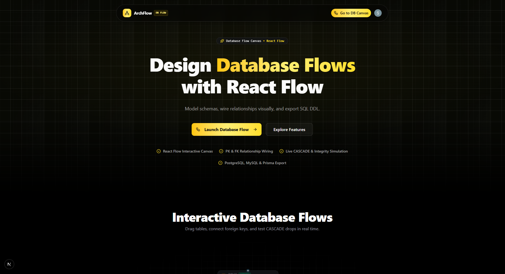

# ArchFlow — Visual Database Schema Flow & Architecture Studio

A modern, visual node-based studio for designing relational database schemas, foreign key flows, and NoSQL data models powered by **React Flow**, **Convex**, and **Google Gemini AI**.

Model entity relationships, trace CASCADE drop flows, enforce referential integrity, and export production-ready SQL and NoSQL DDL with one click.

---



## 🚀 Key Features

### 1. Interactive Database Flow Canvas
- Built with **React Flow (@xyflow/react v12)** with smooth panning, zooming, mini-map navigation, and one-click auto-layout via **Dagre**.
- Dual schema support: seamlessly switch between **SQL Relational** and **NoSQL Document** architectures.

### 2. Comprehensive Node Modeling
- **Relational SQL Entities:** `Tables` (typed columns, Primary Key, Foreign Key, Unique, and Nullable constraints), `Views`, `Indexes`, `Functions`, `Triggers`, and `Enums`.
- **Document NoSQL Entities:** `Collections`, `Documents`, `Embedded Objects`, `References`, and `Validation Schemas`.
- **Shared Design Entities:** `Sticky Notes`, `Domain Schema Headers`, and `Text Annotations`.

### 3. Column-Level ER Relationship Wiring & Cardinality
- Connect PK to FK handles directly across table nodes.
- Configure cardinalities (`1:1`, `1:N`, `N:M`, `N:1`) with animated connectors and standard crow's foot notation (`||—|{`, `||—o{`, `||—||`).

### 4. CASCADE Drop Impact Simulator (Referential Integrity Studio)
- Deep dependency inspection: trace foreign key severing in both directions (`incoming` and `outgoing`), calculate 2nd-level transitive cascades, and detect broken SQL views.
- Risk severity scoring (`SAFE`, `MODERATE`, `HIGH`) with plain-English impact explanations.
- Simulated DDL preview for PostgreSQL, MySQL, and MongoDB.
- Canvas highlighting: temporarily pulses affected tables and views directly on the React Flow canvas.

### 5. Multi-Domain Containers & Subgraph Grouping
- Group related database entities into bounded contexts (e.g., *Auth*, *Billing*, *Orders*, *Inventory*, *Catalog*) with distinct color palettes, domain badges, and drag-together containers.

### 6. Production Code Exporters & Mermaid Integration
- **SQL DDL Exporter:** Generates clean, syntax-highlighted DDL scripts for **PostgreSQL**, **MySQL**, **SQLite**, and **Prisma** schema models with [Shiki](https://shiki.style/).
- **NoSQL Exporter:** Generates executable **MongoDB** shell scripts and collection validation rules.
- **Mermaid Import & Export:** Bi-directional import and export of Mermaid ER diagrams.
- **High-Resolution Image Export:** Export PNG and SVG diagrams for RFCs and repository documentation.

### 7. AI Prompt-to-Schema Copilot
- Natural language to database schema generation powered by Google Gemini AI.
- Automated schema normalization, primary/foreign key inference, and index optimization.

### 8. Subscription Tiers & Feature Gating
- **Hobbyist Free:** 1 project quota, visual canvas, and SQL/NoSQL DDL export.
- **Pro Architect:** 15 projects quota, Multi-Domain grouping, CASCADE Drop Simulator, and Mermaid import/export.
- **AI Architect Pro:** Unlimited projects (9999), AI Prompt-to-Schema Copilot, and live AI Studio Agent chat.

---

## 💳 Payment & Subscription Architecture (Razorpay)

ArchFlow includes an end-to-end, production-ready subscription and checkout infrastructure powered by **Razorpay**:

```
[User Clicks Upgrade]
         │
         ▼
[1. Next.js API (/api/razorpay/create-order)] ──► Validates Plan & Generates Razorpay Order ID
         │
         ▼
[2. Razorpay Client SDK Modal] ───────────────► User Completes Payment (UPI, Card, NetBanking)
         │
         ▼
[3. Next.js API (/api/razorpay/verify-payment)] ─► HMAC-SHA256 Cryptographic Signature Verification
         │
         ▼
[4. Convex Backend (api.payments.RecordPayment)] ──► Updates UserTable subscription & resets quotas
```

### 1. Payment Methods Supported
- **UPI:** Instant payment via Google Pay, PhonePe, Paytm, and BHIM QR.
- **Credit & Debit Cards:** Visa, MasterCard, RuPay, and Maestro.
- **NetBanking:** 50+ major Indian banks supported.
- **Digital Wallets:** Paytm, Mobikwik, and supported net wallets.

### 2. Multi-Cycle Billing & Pricing Plans
- **Monthly Billing:** 30 days validity per billing cycle.
- **Yearly Billing:** 365 days validity with ~17% discounted yearly rates.
- **Promotional Discounts:** Built-in discount percentages with strikethrough original pricing and expiry date countdowns.
- **In-App Billing History:** Users can view their transaction log, download payment receipts, inspect Razorpay IDs, and track renewal dates in `/dashboard/pricing`.

### 3. Server-Side Quota Enforcement
- Gating checks are strictly enforced both client-side via `canAccessFeature()` (`lib/planAccess.tsx`) and server-side in Convex mutations (`convex/agent.ts`).
- Any attempt to create projects past a tier's quota (`PLAN_QUOTAS[userPlan]`) is rejected at the database level.

---

## 🛠️ Tech Stack

| Category | Technology |
| :--- | :--- |
| **Frontend Framework** | [Next.js 16](https://nextjs.org/) (App Router, Turbopack, React 19) |
| **Language & Typing** | [TypeScript](https://www.typescriptlang.org/) (Strict Mode) |
| **Visual Canvas** | [@xyflow/react](https://reactflow.dev/) (React Flow v12) |
| **Graph Auto-Layout** | [Dagre](https://github.com/dagrejs/dagre) |
| **Real-time Backend** | [Convex v1.28](https://www.convex.dev/) (Serverless Reactive Backend) |
| **Authentication** | [Clerk](https://clerk.com/) (`@clerk/nextjs`) |
| **Payments** | [Razorpay](https://razorpay.com/) (Client Checkout SDK + Webhook API) |
| **AI & LLM Workflows** | [Google Gemini AI](https://ai.google.dev/) (`@google/generative-ai`), LangChain, LangGraph |
| **Styling & Theme** | [Tailwind CSS 4](https://tailwindcss.com/), Radix UI Primitives, Lucide React, `next-themes` |
| **Syntax Highlighting** | [Shiki v3](https://shiki.style/) |
| **Image Rendering** | [html-to-image](https://github.com/bubkoo/html-to-image) |
| **Security & Inspection** | [Arcjet](https://arcjet.com/) (`@arcjet/next`, `@arcjet/inspect`) |

---

## 🔐 Environment Variables

```env
CONVEX_DEPLOYMENT=
NEXT_PUBLIC_CONVEX_URL=
NEXT_PUBLIC_CLERK_PUBLISHABLE_KEY=
CLERK_SECRET_KEY=
NEXT_PUBLIC_CLERK_SIGN_IN_URL=/sign-in
NEXT_PUBLIC_CLERK_SIGN_UP_URL=/sign-up
NEXT_PUBLIC_CLERK_SIGN_IN_FALLBACK_REDIRECT_URL=/dashboard
NEXT_PUBLIC_CLERK_SIGN_UP_FALLBACK_REDIRECT_URL=/dashboard
RAZORPAY_KEY_ID=
NEXT_PUBLIC_RAZORPAY_KEY_ID=
RAZORPAY_KEY_SECRET=
GOOGLE_API_KEY=
ARCJET_KEY=
NEXT_PUBLIC_APP_URL=http://localhost:3000
```

---

## 📦 Getting Started

### Prerequisites

- **Node.js**: `>= 18.18.0` (Recommended: Node `v20.x` or `v24.x`)
- **Package Manager**: `npm` only (maintain `package-lock.json`)

### Installation & Local Setup

1. **Clone the repository:**
   ```bash
   git clone https://github.com/your-username/ai-agent-builder-platform.git
   cd ai-agent-builder-platform
   ```

2. **Install dependencies:**
   ```bash
   npm install
   ```

3. **Configure Environment Variables:**
   Create `.env.local` using the template documented in the [Environment Variables](#-environment-variables) section above.

4. **Start the Development Servers:**

   Open two separate terminal windows:

   **Terminal 1 (Next.js Frontend):**
   ```bash
   npm run dev
   ```

   **Terminal 2 (Convex Backend):**
   ```bash
   npx convex dev
   ```

5. **Open the Studio:**
   Navigate to [http://localhost:3000](http://localhost:3000) in your browser.

---

## 🧪 Verification & Code Quality

Before committing changes or creating pull requests, ensure all checks pass:

```bash
# 1. Strict TypeScript compilation check (must exit with 0 errors)
npx tsc --noEmit

# 2. ESLint code validation
npm run lint

# 3. Next.js production build check
npm run build
```

---

## 📂 Project Architecture

```text
├── app/
│   ├── (auth)/                    # Clerk sign-in / sign-up routes
│   ├── admin/                     # Admin dashboards (analytics, earnings, feedback, plans, users)
│   ├── agent-builder/             # Visual schema canvas workspace
│   │   ├── [agentId]/             # Dynamic route per schema project
│   │   ├── _components/           # Studio tools, header, chat drawer, CascadeSimulatorDialog
│   │   ├── _customNodes/          # React Flow custom SQL & NoSQL table nodes
│   │   └── _customEdges/          # ER relationship edges & cardinality markers
│   ├── api/                       # API route handlers (AI chat, Razorpay checkout & webhook)
│   ├── dashboard/                 # Projects dashboard & template selector
│   │   └── pricing/               # Subscription tiers & Razorpay checkout
│   ├── globals.css                # Tailwind CSS 4 theme variables
│   ├── layout.tsx                 # Root layout with ClerkProvider & ConvexClientProvider
│   └── page.tsx                   # Landing page
├── components/
│   ├── feedback/                  # User feedback modal
│   ├── landing/                   # Hero, Features, Pricing, InteractiveLab, Navbar, Footer
│   ├── plans/                     # LockedFeatureToast.tsx, PlanUpgradeModal.tsx
│   └── ui/                        # Reusable Radix UI primitives
├── context/                       # React contexts (WorkflowContext, UserDetailContext)
├── convex/                        # Convex reactive mutations, queries, actions & schema.ts
├── lib/                           # Core utilities, autoLayout, exporters (SQL, NoSQL, Mermaid)
│   ├── ai/                        # LangGraph AI agent orchestration
│   ├── planAccess.tsx             # Canonical subscription tiers, feature flags & quotas
│   ├── razorpayClient.ts          # Razorpay SDK loader & types
│   ├── schemaClassifier.ts        # SQL vs NoSQL schema detector
│   └── sqlDdlExporter.ts          # Relational DDL exporter
└── types/                         # Shared TypeScript interfaces (AgentTypes.tsx)
```
