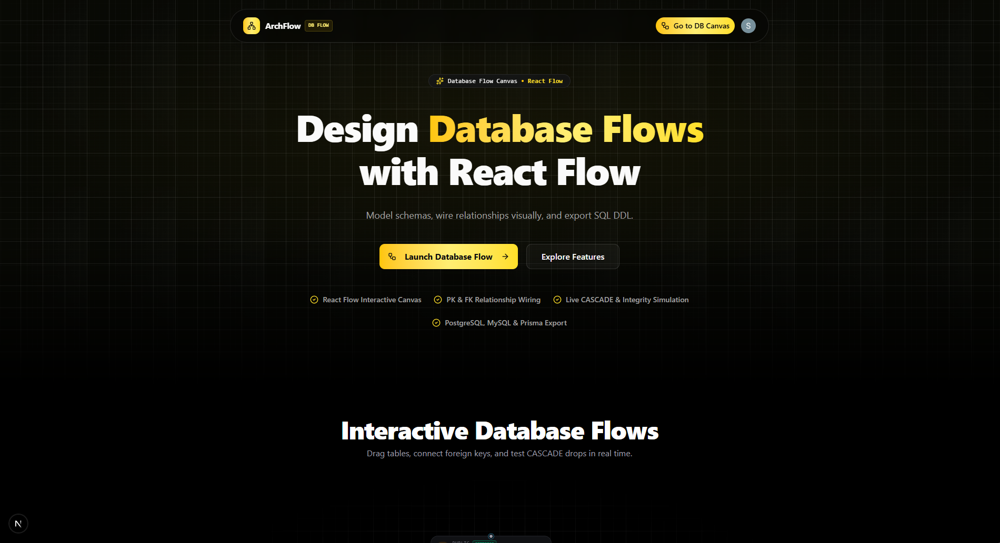

# ArchFlow — Visual Database Flow & Schema Studio

A modern, visual node-based studio for designing relational database schemas, foreign key flows, and NoSQL data models powered by **React Flow** and **AI**.

Model entity relationships, trace cascade flows, and export production-ready SQL DDL with one click.

---



## 🚀 Features

- **Interactive Database Flow Canvas**: Built with [React Flow (@xyflow/react)](https://reactflow.dev/). Drag tables, pan, zoom, and auto-layout schemas with Dagre.
- **Rich SQL & NoSQL Node Modeling**:
  - **Relational SQL**: `Tables` (typed columns, PK, FK, Unique, Nullable constraints), `Views`, `Indexes`, `Functions`, `Triggers`, and `Enums`.
  - **Document NoSQL**: `Collections`, `Documents`, `Embedded Objects`, `References`, and `Validation Schemas`.
  - **Shared Entities**: `Sticky Notes`, `Domain Schema Headers`, and `Annotations`.
- **Column-Level ER Relationship Wiring**:
  - Connect primary key to foreign key handles directly.
  - Configure cardinalities (`1:1`, `1:N`, `N:M`) with animated relationship edges and crow's foot notation.
- **CASCADE Drop & Integrity Simulation**:
  - Test `ON DELETE CASCADE` effects and dependency chains before running migrations in production.
- **Production SQL DDL & Migration Exporter**:
  - Export clean, syntax-highlighted DDL scripts for **PostgreSQL**, **MySQL**, **SQLite**, and **Prisma** schema models with [Shiki](https://shiki.style/).
- **Mermaid Import & High-Resolution Diagram Export**:
  - Import existing Mermaid ER diagrams directly onto the canvas.
  - Export high-resolution PNG or SVG diagrams for RFCs and repository documentation.
- **AI Schema Copilot**:
  - Prompt with natural language using Google Gemini to auto-generate normalized schemas, indexes, and foreign keys.
- **Domain Containers & Subgraph Grouping**:
  - Group related entities into bounded contexts (e.g. *Auth*, *Billing*, *Orders*, *Inventory*) with distinct theme badges.
- **Cloud Persistence & Collaboration**:
  - Real-time cloud storage and sync powered by [Convex](https://www.convex.dev/).
- **Authentication**:
  - Secure user accounts and organization management powered by [Clerk](https://clerk.com/).

---

## 🛠️ Tech Stack

- **Framework**: [Next.js 16](https://nextjs.org/) (App Router, Turbopack)
- **Language**: [TypeScript](https://www.typescriptlang.org/)
- **Visual Flow Engine**: [React Flow (@xyflow/react)](https://reactflow.dev/)
- **Graph Layout**: [Dagre](https://github.com/dagrejs/dagre)
- **AI Engine**: [Google Generative AI (Gemini)](https://ai.google.dev/)
- **Backend & Database**: [Convex](https://www.convex.dev/)
- **Authentication**: [Clerk](https://clerk.com/)
- **Styling**: [Tailwind CSS 4](https://tailwindcss.com/)
- **UI Components**: [Radix UI](https://www.radix-ui.com/), [Lucide React](https://lucide.dev/)
- **Code Syntax Highlighting**: [Shiki](https://shiki.style/)
- **Canvas Image Export**: [html-to-image](https://github.com/bubkoo/html-to-image)

---

## 📦 Getting Started

### Prerequisites

- Node.js (v18.18 or higher)
- npm, yarn, or pnpm

### Installation

1. **Clone the repository**

   ```bash
   git clone https://github.com/your-username/ai-agent-builder-platform.git
   cd ai-agent-builder-platform
   ```

2. **Install dependencies**

   ```bash
   npm install
   ```

3. **Configure Environment Variables**

   Create a `.env.local` file in the root directory:

   ```env
   # Convex
   CONVEX_DEPLOYMENT=
   NEXT_PUBLIC_CONVEX_URL=

   # Clerk Authentication
   NEXT_PUBLIC_CLERK_PUBLISHABLE_KEY=
   CLERK_SECRET_KEY=

   # Google Gemini AI (Optional for AI Schema Copilot)
   GEMINI_API_KEY=
   ```

4. **Run the Development Servers**

   Run both the Next.js app and the Convex backend:

   **Terminal 1 (Next.js Frontend):**
   ```bash
   npm run dev
   ```

   **Terminal 2 (Convex Backend):**
   ```bash
   npx convex dev
   ```

5. **Open the Application**

   Visit [http://localhost:3000](http://localhost:3000) to design database flows.

---

## 📂 Project Structure

```text
├── app/
│   ├── (auth)/                    # Sign-in and sign-up pages (Clerk)
│   ├── agent-builder/             # Core visual schema flow canvas
│   │   ├── [agentId]/             # Workspace per schema project
│   │   ├── _components/           # Schema tools, mini-map, DDL export dialogs
│   │   ├── _customNodes/          # React Flow custom SQL & NoSQL table nodes
│   │   └── _customEdges/          # React Flow ER relationship edges
│   ├── dashboard/                 # Schema dashboard, projects list, templates
│   ├── globals.css                # Tailwind CSS 4 theme variables
│   ├── layout.tsx                 # Root layout & providers
│   └── page.tsx                   # Landing page
├── components/
│   ├── landing/                   # Hero, InteractiveLab, Features, Pricing, etc.
│   └── ui/                        # Reusable Radix UI primitives
├── convex/                        # Convex backend mutations, queries & schema
├── lib/                           # Domain themes, utilities & helpers
└── types/                         # TypeScript interfaces
```

---

## 🤝 Contributing

Contributions are welcome! Please feel free to submit issues or pull requests to help improve the database flow studio.

---

## 📄 License

This project is licensed under the MIT License.
