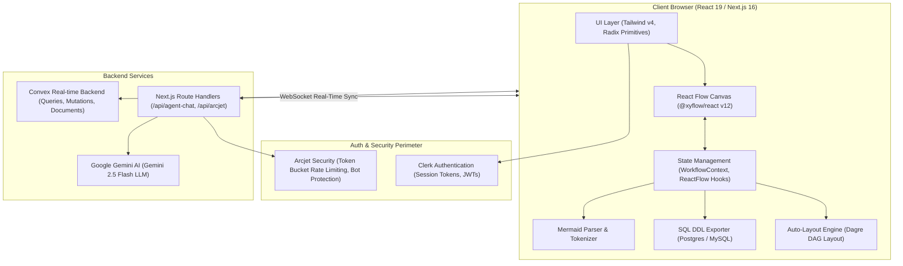
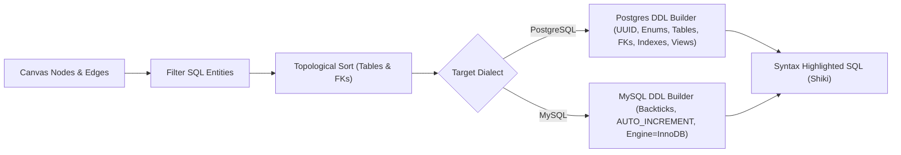

# System Architecture — ArchFlow

**Architecture Version:** 2.0.0  
**Stack:** Next.js 16 (App Router) | React 19 | TypeScript 5 | React Flow (@xyflow/react 12) | Convex | Clerk | Arcjet | Google Gemini

---

## 1. System Overview

ArchFlow is structured as a client-first, cloud-persisted single-page visual studio. The architecture decouples the high-frequency visual graph manipulation engine on the client from the distributed persistence layer on Convex and the external AI/Security microservices.



---

## 2. Frontend Architecture

### 2.1 Directory Structure & Boundaries
```text
app/
├── (auth)/                    # Sign-in and sign-up pages routed through Clerk
├── agent-builder/             # Core visual schema flow studio
│   ├── [agentId]/             # Dynamic workspace route per schema project
│   ├── _components/           # Visual tools, inspector panels, dialogs
│   │   ├── AgentToolsPanel.tsx    # Node palette (SQL, NoSQL, Domain containers)
│   │   ├── SettingPanel.tsx       # Dynamic attribute inspector for selected nodes
│   │   ├── Header.tsx             # Canvas toolbar, project naming, modal triggers
│   │   ├── SqlExportDialog.tsx    # SQL DDL export modal with dialect switches
│   │   ├── MermaidImportDialog.tsx# Mermaid code importer & live preview
│   │   ├── ExportImageDialog.tsx  # High-resolution PNG/SVG canvas capture
│   │   ├── FlowControls.tsx       # Viewport zoom, lock, background switches
│   │   └── FlowMiniMap.tsx        # Canvas radar navigation
│   ├── _customNodes/          # React Flow custom node components
│   │   ├── nodeTypes.ts           # Central node registry mapping
│   │   ├── SqlTableNode.tsx       # Relational table with column-level handles
│   │   ├── SqlViewNode.tsx        # Views & Materialized views
│   │   ├── SqlIndexNode.tsx       # B-Tree, GIN, GiST index nodes
│   │   ├── SqlEnumNode.tsx        # Custom enum declarations
│   │   ├── SqlFunctionNode.tsx    # Stored procedures & UDFs
│   │   ├── SqlTriggerNode.tsx     # Table triggers
│   │   ├── NosqlCollectionNode.tsx# Document collection definitions
│   │   ├── DomainGroupNode.tsx    # Bounded context container subgraphs
│   │   └── DbNoteNode.tsx         # Sticky notes and annotations
│   └── _customEdges/          # Custom relationship edges
│       └── ErRelationshipEdge.tsx # Animated ER crow's foot relationship links
├── dashboard/                 # Projects list, templates, creation wizard
├── api/                       # Edge & Node route handlers
├── layout.tsx                 # Root layout, theme provider, Clerk & Convex wrappers
├── provider.tsx               # Client state context hydration
└── globals.css                # Tailwind CSS v4 variables & design tokens
```

### 2.2 React Flow Node & Edge Integration
1. **Node Registry (`nodeTypes.ts`):** All custom nodes are memoized and registered outside component render loops to avoid unmount/remount flickering during canvas state modifications.
2. **Column-Level Handles:** `SqlTableNode` renders individual `<Handle>` elements per column (source handle on the right for Primary Keys, target handle on the left for Foreign Keys). Handle IDs follow the pattern `col-<columnId>-source` and `col-<columnId>-target`.
3. **Custom Edges (`ErRelationshipEdge.tsx`):** Renders smooth cubic bezier or step curves with cardinality labels (`1:1`, `1:N`, `N:M`), animated gradient strokes, and onDelete behavior tags.

### 2.3 State Management & Context Layer
- **`WorkflowContext`:** Holds shared canvas states:
  - `addedNodes: Node[]`: Current list of React Flow nodes on canvas.
  - `nodeEdges: Edge[]`: Current list of relationships and foreign key connections.
  - `selectedNode: Node | null`: The currently active node for editing in `SettingPanel`.
- **`UserDetailContext`:** Holds the authenticated user's database record synchronized from Clerk into Convex (`UserTable`).
- **`ReactFlowProvider`:** Encloses the canvas and panels to supply viewport utilities (`fitView`, `deleteElements`, `getNodes`, `getEdges`, `screenToFlowPosition`).

---

## 3. Data Processing & Algorithmic Engines

### 3.1 Directed Acyclic Graph (DAG) Auto-Layout (`lib/autoLayout.ts`)
- Utilizes `dagre` graph layout library with customizable direction (`TB` top-to-bottom or `LR` left-to-right).
- **Domain Container Isolation:** Calculates bounding boxes for tables nested within `DomainGroupNode` containers and preserves contextual boundaries during auto-layout execution.
- **Topological Rank Sorting:** Positions root entity tables (independent entities without foreign keys) at the primary rank and descends down through foreign key dependencies to prevent edge crossings.

### 3.2 SQL DDL Exporter Pipeline (`lib/sqlDdlExporter.ts`)

- **Order of Execution in Generated SQL:**
  1. Extensions (`uuid-ossp`, `pgcrypto`)
  2. Custom Enums (`CREATE TYPE ... AS ENUM`)
  3. Tables without foreign keys
  4. Dependent tables with foreign keys (or `ALTER TABLE ADD CONSTRAINT` for circular references)
  5. Indexes (`CREATE INDEX ...`)
  6. Views (`CREATE VIEW ...`)
  7. Triggers and Functions

### 3.3 Mermaid Parser Engine (`lib/mermaidParser.ts`)
- Reads raw Mermaid syntax (`erDiagram`, `flowchart TD`, `graph LR`).
- Extracts entity names, attributes, types, and primary/foreign key flags.
- Maps relationship tokens (`||--o{`, `}|--|{`, `-->`) into typed React Flow edges with proper source and target column IDs.
- Dispatches layout through Kahn's algorithm before rendering onto the canvas.

---

## 4. Backend & Persistence Architecture (Convex)

Convex provides a serverless, reactive document database with automatic WebSocket subscription synchronization.

### 4.1 Schema Definition (`convex/schema.ts`)
- **`UserTable`:** Tracks user identity, email, avatar, subscription tier, and token quota.
- **`AgentTable`:** Represents a database schema project. Stores the full canvas graph (`nodes`, `edges`), metadata, publication status, and AI tool configurations.
- **`ChatTable`:** Stores session chat history for the AI schema copilot.

### 4.2 Reactive Mutation Flow
1. User modifies a node (e.g., adds a column) or drags tables on the canvas.
2. Local state updates immediately for zero-latency interactions (optimistic local update).
3. Debounced or user-triggered save calls Convex mutation `api.agent.UpdateAgentDetail`.
4. Convex patches the document in real time and broadcasts updates across active client sessions.

---

## 5. Authentication, Proxy & Middleware (Clerk)

- **Authentication Provider:** `@clerk/nextjs` with dark theme styling.
- **Session Protection:** Handled via `proxy.ts` (configured with `clerkMiddleware`).
- **Route Matching:**
  - Public routes: `/`, `/sign-in(.*)`, `/sign-up(.*)`
  - Protected routes: `/dashboard(.*)`, `/agent-builder(.*)`, `/api/(.*)`
- **Clock Skew Tolerance:** Configured with `clockSkewInMs: 60000` to prevent transient timestamp validation failures.

---

## 6. AI & Copilot Architecture (Google Gemini)

- **SDK:** `@google/generative-ai` (`gemini-2.5-flash`).
- **Endpoint:** `POST /api/agent-chat` and `POST /api/generate-agent-tool-config`.
- **Structured Response Generation:** System prompts enforce strict JSON schemas for automated translation into canvas nodes, columns, and relationship edges.
- **Error Handling:** Fallback parsers strip Markdown code fences (````json ... ````) before serializing payloads to prevent runtime JSON parsing errors.

---

## 7. Rate Limiting & Protection (Arcjet)

- **Package:** `@arcjet/next`.
- **Mechanism:** Token bucket rate limiter tracking authenticated `userId` or client IP.
- **Refill Policy:** Live enforcement with capacity thresholds (e.g., 5,000 tokens / 30-day billing cycle) preventing bot abuse and Denial-of-Wallet attacks on LLM API endpoints.
