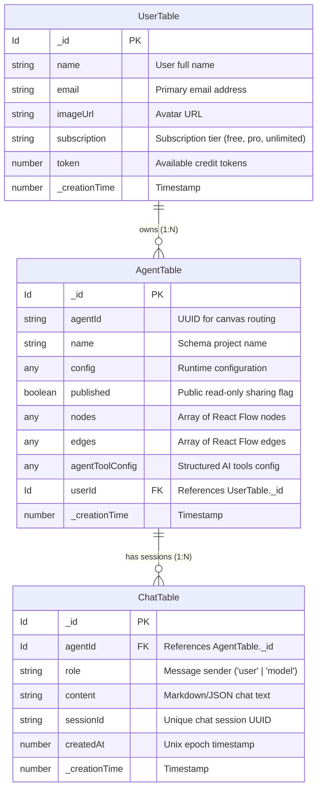

# Database Architecture & Schemas — ArchFlow

**Platform:** Convex Serverless Reactive Database  
**Document Version:** 2.0.0  
**Source File:** `convex/schema.ts`  

---

## 1. Overview

ArchFlow uses **Convex** as its primary cloud database and backend runtime. Convex provides ACID-compliant document storage, real-time WebSocket subscriptions, and end-to-end TypeScript type safety across queries and mutations.

The database stores user profiles, visual schema projects (canvases containing nodes, edges, and domain configurations), and AI chat interaction sessions.

---

## 2. Entity-Relationship Model



---

## 3. Table Schemas & Data Dictionaries

### 3.1 `UserTable`
Stores authenticated user records synchronized from Clerk webhooks or the root client authentication provider.

| Field Name | Type | Constraints | Description |
| :--- | :--- | :--- | :--- |
| `_id` | `Id<"UserTable">` | Primary Key, Auto-generated | Unique internal Convex document identifier |
| `name` | `string` | Required | User's full display name |
| `email` | `string` | Required, Indexed | Primary authenticated email address |
| `imageUrl` | `string` | Required | Profile avatar image URL |
| `subscription`| `string` | Optional | User's active subscription tier (e.g. `"unlimited_plan"`) |
| `token` | `number` | Required, Default `5000` | Token credit balance for canvas creation & AI Copilot |
| `_creationTime`| `number` | System Field | Timestamp (ms) when the user record was created |

### 3.2 `AgentTable` (Database Schema Canvas)
The primary storage entity representing a complete visual database schema design project.

| Field Name | Type | Constraints | Description |
| :--- | :--- | :--- | :--- |
| `_id` | `Id<"AgentTable">` | Primary Key, Auto-generated | Convex document identifier |
| `agentId` | `string` | Required, UUID | External routing UUID used in `/agent-builder/[agentId]` |
| `name` | `string` | Required | Schema project display name |
| `userId` | `Id<"UserTable">`| Required, Foreign Key | References the owning user |
| `published` | `boolean` | Required, Default `false` | When true, allows public read-only viewing |
| `nodes` | `any` (Array) | Optional | Serialized array of React Flow node objects |
| `edges` | `any` (Array) | Optional | Serialized array of React Flow edge objects |
| `config` | `any` (Object)| Optional | Project-level canvas settings (background, layout, etc.) |
| `agentToolConfig`| `any` (Object)| Optional | AI Copilot tool definitions and generated system prompts |
| `_creationTime`| `number` | System Field | Creation timestamp (ms) |

### 3.3 `ChatTable`
Persists conversational threads between the user and the Gemini AI Copilot for a specific database schema canvas.

| Field Name | Type | Constraints | Description |
| :--- | :--- | :--- | :--- |
| `_id` | `Id<"ChatTable">` | Primary Key, Auto-generated | Convex document identifier |
| `agentId` | `Id<"AgentTable">`| Required, Foreign Key | Identifies the associated schema canvas |
| `sessionId` | `string` | Required | UUID identifying the active chat window |
| `role` | `string` | Required | `"user"` or `"model"` |
| `content` | `string` | Required | The raw prompt or LLM markdown response |
| `createdAt` | `number` | Required | Timestamp of message dispatch |

---

## 4. Canvas Document Formats (`nodes` and `edges`)

### 4.1 SQL Table Node JSON Structure (`SqlTableNode`)
```json
{
  "id": "table-1718000000000",
  "type": "SqlTableNode",
  "position": { "x": 250, "y": 150 },
  "data": {
    "label": "users",
    "name": "users",
    "schema": "public",
    "comment": "Core identity table",
    "columns": [
      {
        "id": "col-uuid-1",
        "name": "id",
        "type": "UUID",
        "isPk": true,
        "isFk": false,
        "isUnique": true,
        "isNullable": false,
        "defaultValue": "gen_random_uuid()"
      },
      {
        "id": "col-uuid-2",
        "name": "email",
        "type": "VARCHAR(255)",
        "isPk": false,
        "isFk": false,
        "isUnique": true,
        "isNullable": false
      },
      {
        "id": "col-uuid-3",
        "name": "organization_id",
        "type": "UUID",
        "isPk": false,
        "isFk": true,
        "isUnique": false,
        "isNullable": true
      }
    ]
  }
}
```

### 4.2 ER Relationship Edge JSON Structure (`ErRelationshipEdge`)
```json
{
  "id": "xy-edge__table-1col-uuid-1-table-2col-uuid-3",
  "source": "table-1",
  "target": "table-2",
  "sourceHandle": "col-uuid-1-source",
  "targetHandle": "col-uuid-3-target",
  "type": "erRelationship",
  "animated": true,
  "data": {
    "cardinality": "1:N",
    "sourceColumn": "id",
    "targetColumn": "organization_id",
    "onDelete": "CASCADE",
    "onUpdate": "RESTRICT"
  }
}
```

### 4.3 Domain Group Node Structure (`DomainGroupNode`)
```json
{
  "id": "domain-auth-1",
  "type": "DomainGroupNode",
  "position": { "x": 100, "y": 80 },
  "data": {
    "name": "Authentication Domain",
    "description": "User credentials, MFA, and sessions",
    "themeKey": "emerald",
    "color": "#10b981",
    "tableCount": 4
  },
  "style": { "width": 640, "height": 480 }
}
```

---

## 5. Backend Operations & Convex Functions

### 5.1 Queries (`convex/agent.ts`, `convex/user.ts`)
- `GetUserAgents({ userId })`: Fetches all schemas belonging to a user, ordered descending by creation date.
- `GetAgentById({ agentId })`: Retrieves a specific schema project canvas by its public UUID.

### 5.2 Mutations (`convex/agent.ts`, `convex/user.ts`)
- `CreateNewUser({ name, email, imageUrl })`: Idempotent upsert verifying existing email. Grants initial `5000` token balance.
- `CreateAgent({ name, agentId, userId, nodes, edges })`: Initializes a new schema canvas.
- `UpdateAgentDetail({ id, nodes, edges })`: Persists updated node layouts and relationship connections.
- `RenameAgent({ agentId, name })`: Validates non-empty title and updates the project name.
- `DuplicateAgent({ agentId, userId })`: Deep-copies an existing canvas graph under a new UUID with `(Copy)` suffix.
- `DeleteAgent({ agentId })`: Permanently removes the schema project from `AgentTable`.

---

## 6. Migration & Scalability Guidelines

1. **Indexes to Implement as Platform Scales:**
   - `UserTable`: Index on `by_email` (`["email"]`).
   - `AgentTable`: Index on `by_user` (`["userId"]`) and `by_agentId` (`["agentId"]`).
   - `ChatTable`: Index on `by_agent_and_session` (`["agentId", "sessionId"]`).
2. **Document Size Limits:** Convex limits single document sizes to 1 MiB. For schemas with hundreds of tables, column definitions should be compressed or stored with optimized key identifiers.
3. **Optimistic Updates:** Client components must update `WorkflowContext` immediately and debounce mutations to `UpdateAgentDetail` by 500ms to reduce unnecessary database writes during active dragging.
