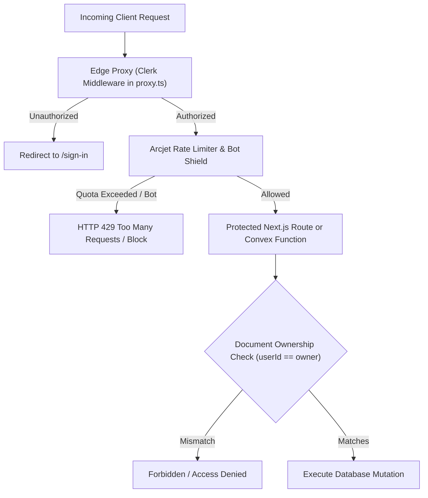

# Security Policy & Architecture — ArchFlow

**Security Standard:** Production-Grade Web Application  
**Document Version:** 2.0.0  
**Scope:** Authentication, Authorization, API Protection, Data Hygiene, Secrets Management  

---

## 1. Security Architecture Overview

ArchFlow enforces defense-in-depth across the client application, edge proxy, serverless API handlers, and real-time database.



---

## 2. Authentication & Session Management (Clerk)

### 2.1 Edge Authentication Middleware (`proxy.ts`)
- All incoming requests (except public assets and `/sign-in`, `/sign-up`, `/`) are evaluated by `@clerk/nextjs/server`.
- **Clock Skew Tolerance:** Configured with `clockSkewInMs: 60000` to prevent transient timestamp validation failures between distributed client clocks and Clerk auth servers.
- **Session Tokens:** Transmitted via secure HTTP-only cookies and cryptographic JWTs.

### 2.2 Identity Synchronization
- When a user logs in, the root application provider synchronizes the Clerk profile (`email`, `name`, `imageUrl`) into Convex (`UserTable`).
- The internal Convex user ID (`Id<"UserTable">`) is stored in `UserDetailContext` and used as the authoritative owner reference on all subsequent canvas creations.

---

## 3. Authorization & Data Isolation

### 3.1 Document Ownership Isolation
- Every canvas document in `AgentTable` contains a mandatory `userId: Id<"UserTable">` attribute.
- Convex queries and mutations filter strictly by the calling user's ID:
```typescript
// Query strictly filtered to user's own records
const results = await ctx.db
  .query("AgentTable")
  .filter((q) => q.eq(q.field("userId"), args.userId))
  .order("desc")
  .collect();
```

### 3.2 Public Sharing Mode
- Canvases marked with `published: true` allow public read-only access for team reviews and RFC documentation.
- Mutation endpoints (`UpdateAgentDetail`, `RenameAgent`, `DeleteAgent`) require ownership verification and reject updates from unauthenticated or non-owner callers.

---

## 4. API Rate Limiting & Denial-of-Wallet Protection (Arcjet)

AI generation endpoints (`/api/agent-chat`, `/api/generate-agent-tool-config`) consume upstream LLM tokens. To prevent automated bot scraping, denial-of-service, or API credit exhaustion:

### 4.1 Token Bucket Algorithm
- **Capacity:** 5,000 requests / token points.
- **Refill Rate:** Fixed quota interval tracked against authenticated `userId` or client IP.
- **Enforcement Mode:** `LIVE` (blocks abusive requests immediately with HTTP 429).

### 4.2 Bot Protection
- Arcjet inspects client headers, browser fingerprints, and request rates to differentiate genuine browser clients from automated scrapers.

---

## 5. Input Sanitization & Injection Defenses

### 5.1 SQL Injection Prevention in DDL Exporter
- The SQL DDL generator in `lib/sqlDdlExporter.ts` produces client-side DDL text for user download; it **never** runs arbitrary raw SQL strings against an internal server database.
- Column names, table names, schema identifiers, and comments are sanitized:
  - PostgreSQL identifiers are quoted: `"table_name"."column_name"`
  - MySQL identifiers are escaped with backticks: `` `table_name`.`column_name` ``
  - String literals and comments are scrubbed of unescaped quotes to prevent script breaks.

### 5.2 XSS (Cross-Site Scripting) Defense
- All user-defined table names, column labels, view queries, and notes are rendered via React 19's virtual DOM, which automatically escapes inline HTML entities.
- Rich-text sticky notes (`DbNoteNode`) use strict sanitization libraries or markdown text renderers that block `<script>`, `<iframe>`, and dangerous `javascript:` URI schemes.

### 5.3 AI Prompt Injection Defenses
- User-supplied schema configurations passed to Google Gemini are encapsulated within strictly formatted system prompts.
- Prompts instruct the LLM to output **pure JSON only**, blocking attempts to inject instruction overrides.
- Responses undergo JSON parsing verification before any data is passed back to the client application.

---

## 6. Secrets & Environment Variable Policy

| Environment Variable | Scope | Exposure | Purpose |
| :--- | :--- | :--- | :--- |
| `NEXT_PUBLIC_CONVEX_URL` | Public | Client & Server | WebSocket endpoint for Convex real-time client |
| `CONVEX_DEPLOYMENT` | Private | Server / Build | Deployment key for Convex CLI |
| `NEXT_PUBLIC_CLERK_PUBLISHABLE_KEY` | Public | Client & Server | Clerk frontend SDK initialization |
| `CLERK_SECRET_KEY` | Private | Server Only | Clerk backend API key for session verification |
| `ARCJET_KEY` | Private | Server Only | Site key for Arcjet security engine |
| `GOOGLE_API_KEY` | Private | Server Only | Google Gemini LLM API authentication |

### Security Rules for Developers:
1. **Never commit `.env` or `.env.local` files to Git.** Verify that `.gitignore` contains `.env`, `.env.local`, and `*.local`.
2. **Never prefix private secrets with `NEXT_PUBLIC_`.** Only public gateway URLs and publishable auth keys belong in the client bundle.
3. **Rotate Compromised Keys Immediately:** If an API key is accidentally committed or leaked, revoke it immediately via the respective provider dashboard (Clerk, Google AI Studio, Convex, Arcjet).

---

## 7. Vulnerability Disclosure

If you discover a security vulnerability in ArchFlow, please report it privately:
- Email: security@archflow.dev (or create a private GitHub Security Advisory)
- Do not disclose security vulnerabilities in public GitHub issues or discussions.
